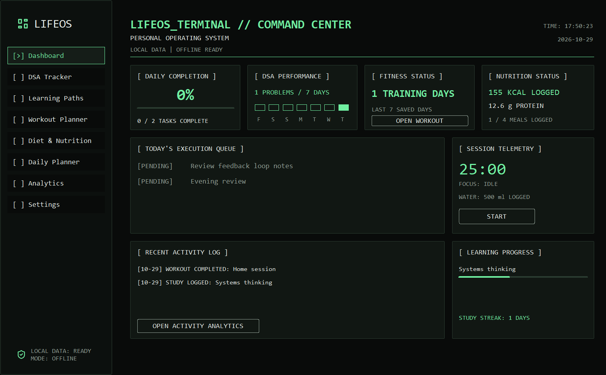
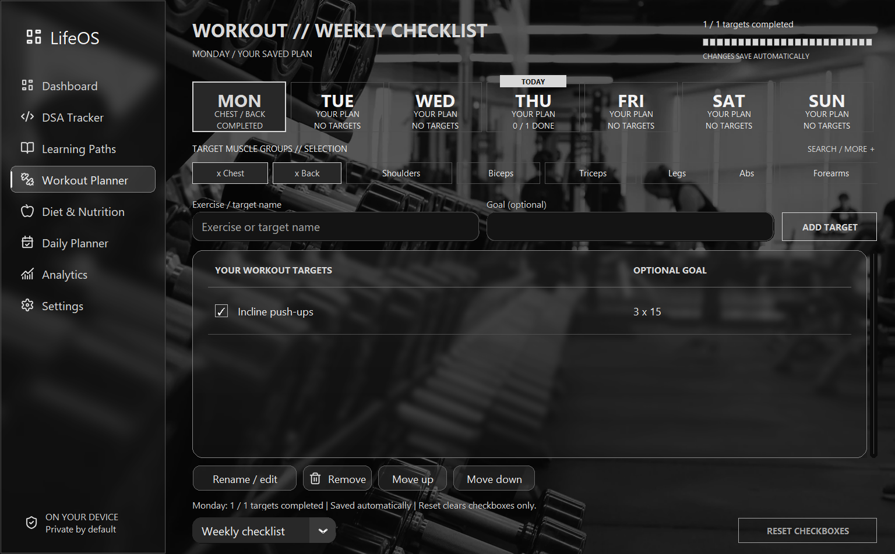
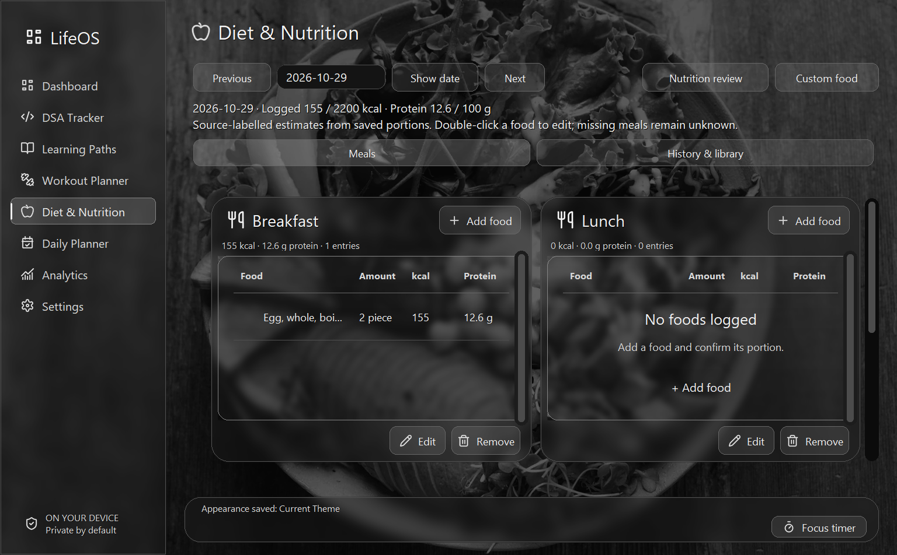

# LifeOS

A local-first Windows desktop workspace for coding practice, learning, fitness, nutrition and daily planning. Built with Python, CustomTkinter, SQLite and Matplotlib. Personal records stay on your computer; tracking, search and calculated progress reviews work offline, without accounts, API keys or a model service.

## Features

| Page | What it does |
| --- | --- |
| Dashboard | Daily tasks, focus timer, learning, workout and nutrition summaries from saved records. |
| DSA Tracker | Problem history, revisions, solution versions and Python syntax highlighting. |
| Learning Paths | Subjects, concepts, understanding, study sessions and progress. |
| Workout Planner | Monday–Sunday plans, multiple muscles, custom targets and auto-saving checkboxes. |
| Diet & Nutrition | Dated breakfast/lunch/snacks/dinner, food search, portions, recipes and daily totals. |
| Daily Planner | Tasks, routines, priorities, deadlines and a persistent focus timer. |
| Analytics | Six chart views for recorded learning, coding, fitness, nutrition and productivity. |
| Settings | Immediate Current/CMD theme switching, adjustable goals, backup and validated restore. |

Two appearances are included: **Current Theme**, with locally bundled monochrome photographic glass, and **CMD / Robotic Command Center**, with green/amber terminal styling. Neither requires restarting the app. The workout checklist does not require starting or finishing a session; earlier measured workout history is preserved separately.

The first launch creates your local profile. It starts with empty personal records and no mandatory learning subjects, workout routine or daily schedule. The food library includes 23 source-labelled composition records and three explicitly approximate reference recipes.

## Screenshots

These are captures of the actual verified Windows application at 150% display scaling, using an isolated test profile. Visible names, counts and food/workout entries are synthetic test fixtures, not personal records. They are screenshots, not interactive previews.

**CMD Dashboard**



**Weekly workout checklist — Current Theme**



**Diet & Nutrition — Current Theme**



## Requirements and source setup

- Windows desktop with Python/Tk support; **Python 3.13.7** is the verified environment.
- Project metadata declares Python 3.11+, but other Python versions have not been verified here. The pinned dependency set is recorded in [requirements.txt](requirements.txt).
- Internet access for the initial dependency installation; normal application use works offline.
- A writable Windows user profile. No administrator access or system-wide package installation is needed.

Open PowerShell in the project folder, then run:

```powershell
powershell -ExecutionPolicy Bypass -File .\Setup.ps1
.\.venv\Scripts\python.exe main.py
```

Setup creates a virtual environment inside this project and installs [requirements.txt](requirements.txt). It does not change global Python packages or machine execution policy. Alternatively:

```powershell
python -m venv .venv
.\.venv\Scripts\python.exe -m pip install -r requirements.txt
.\.venv\Scripts\python.exe main.py
```

After setup, you can also double-click **[Launch LifeOS.cmd](Launch%20LifeOS.cmd)**. Use `--data-dir .test-artifacts\separate-profile` for a separate local test profile. The normal profile is independent of the project folder and survives moving or upgrading the application.

## Packaged Windows application

The locally built, verified application is `dist\LifeOS\LifeOS.exe`. Double-click it and keep the **entire LifeOS folder**, including `_internal`, together. No separate Python installation, virtual environment or VS Code is required. See [portable launch instructions](PORTABLE_README.txt).

Generated executables, archives and the `dist` directory are excluded from the source repository. A source checkout therefore does not include this binary, and no GitHub download or release is currently advertised. Older local archives are previous builds, not the current checklist version.

**The executable is unsigned Windows x64 software. Testing in a clean Windows VM or on another machine is still outstanding.** Verification so far was on the development Windows desktop, including relocation outside the project and ordinary restarts with isolated data. This preparation task does not rebuild or republish the executable.

For the separately generated local Windows installer, run `dist\installer\LifeOS-Setup.exe`. It installs to Program Files by default, offers Start Menu/optional desktop shortcuts and adds a standard uninstall entry. SQLite data stays in the existing per-user profile and is retained on uninstall. See [installer instructions and verification limits](installer/README.md). This wraps the verified application folder without rebuilding the application; generated installer files remain excluded from the source repository.

## Using your workspace

- **Dashboard:** the supplied reference's three-column composition, with Today's Mission, Focus Session, Today's Schedule, Learning Progress, Workout, Nutrition, DSA Activity and Daily Analytics. Mission checkboxes save actual task status. Focus supports Start, Pause, Resume and Finish; its ring shows elapsed session time. Schedule rows come from your own routines/tasks, learning bars from recorded study/understanding, and charts from saved focus/DSA history. Each card's detail control opens the corresponding existing page. Empty records produce meaningful empty states, with no sample history or mandatory subjects.
- **DSA Tracker:** create problems with platform, URL, topic/subtopic, difficulty, attempt/solution dates, revision date, time, attempts, assistance, approach, complexities and notes. Add initial and optimized code in **Solution versions**. Code supports multiline editing, undo, Python highlighting and Copy; it is never executed. Only `Independent` solves count as independent; `Hints` and `Copied` are reported separately. A solved problem needs a solution date.
- **Learning Paths:** create any subject in **Subjects**, then add **Concepts** with prerequisites, notes, exercises, code, understanding, quiz results and revisions. Record actual/planned study time in **Study sessions**. Logging study time never marks a concept understood. Optional concept references must belong to the selected subject.
- **Workout Planner:** select Monday-Sunday, choose muscle groups, type any exercise/target name and optional goal (for example `Push-ups` / `3 x 15`), then **Add target** or press Enter. Tick/untick rows directly; no active session, readiness form, set logger or Finish action is required. Add, rename/edit, remove and move targets with the simple row controls. Plans, muscles and checkboxes save automatically; incomplete text drafts survive changing days, navigating away and normal application restart. Progress is the count of checked targets. **Reset checkboxes** asks confirmation, clears only that day's checks and keeps its targets/muscles; a snapshot is retained in **Workout history > Checklist resets**. Checks remain until explicitly reset, including across calendar weeks. Both Current and CMD themes work immediately. **Search / More** retains optional muscle regions and custom muscle names. **Workout history** also shows earlier plans and measured sessions read-only, including their saved sets. **Fitness progress** retains body/strength charts from those earlier measurements; checklist ticks do not claim measured reps or resistance.
- **Diet & Nutrition:** choose a date with Show date, Enter or Previous/Next. Breakfast, Lunch, Snacks and Dinner each have Add food, calorie/protein totals and editable portions; the same food can appear in multiple meals. Double-click a food or select Edit to change quantity/unit/date/meal; Remove confirms deletion of that entry only. Food search accepts `2 eggs`, `150 g chicken`, `1 cup cooked rice` and `250 ml milk`. Confirm the exact food/preparation before saving. Custom food starts required source/macro fields blank, so values must come from your label or reference; missing micronutrients remain unknown. History & library retains all dated entries, foods/recipes, water and measurements. Nutrition review retains weekly trends and practical meal ideas.

- **Daily Planner:** tasks have dates, deadlines, priorities, categories, status and planned/actual time. Daily routines specify weekdays and reminder times. **Generate today** is idempotent and also runs at startup. The timer dock starts, pauses, resumes and finishes focus sessions; it persists across restarts. Add manual focus or study history in the appropriate tabs.
- **Analytics:** choose dates and one of six views for DSA/topic/difficulty, learning/status, workout consistency/strength, nutrition, water/weight, and task/focus trends. Targets use dated goal history. Chart toolbar supports zoom and saving a chart. Empty history remains empty rather than displaying sample data.
- **Settings:** Appearance / Theme switches immediately between Current Theme and CMD / Robotic Command Center; no restart is required. The selection persists. Edit goals, display preferences, detail mode and reminders in the other sections. Subject goals are on Subjects; workout schedules and preferences are on Workout Planner; routine reminders are on Daily Planner. All are editable without code changes.

The general record tables support search, field filtering, sorting by column, editing, confirmed deletion and CSV export. The simplified workout checklist has its own direct controls; earlier workout history is read-only. CSV exports include code/notes; strings starting with spreadsheet formula characters are escaped for spreadsheet safety. New linked forms remember a recently selected parent as a convenience; verify the selection before saving.

## Nutrition sources and accuracy

[lifeos/nutrition.py](lifeos/nutrition.py) contains offline, per-100-g typical composition values labelled from **USDA FoodData Central / SR Legacy**: <https://fdc.nal.usda.gov/>. The source names are retained on meal snapshots. Exact brands, edible sizes, raw/cooked state and oil change results. These are approximate composition references, not a live verified match to every food or an official Indian food database.

The idli, sambar and chapati entries are **calculated reference recipes**, with ingredient amounts and final yield disclosed in their library notes. They are not measured Indian food standards. Replace them with your actual weighed recipe for better estimates. The recipe builder scales ingredient nutrients by final cooked weight; added water changes yield, not calories. Missing micronutrients stay unknown. Detailed mode shows known totals and the number of entries with missing values. Vitamin values are not supplied where this local library lacks reliable data.

No nutrition API key is required. There is no live online food lookup in this version; the local library, recipe builder and manual custom-food entry work offline. All nutrition calculations use logged portions and the local food library.

## Storage, backups and restore

Normal Windows storage: `%LOCALAPPDATA%\LifeOS\lifeos.sqlite3`. Logs and automatic backups are alongside it. `LIFEOS_DATA_DIR` or `--data-dir` can select a different profile.

- An automatic backup is created on the first launch each day. Backups are retained; move or remove old backup files yourself when appropriate.
- For a manual backup, use **Settings → Create backup** and choose a new filename. Backups use SQLite's consistent backup API, including committed WAL data.
- To restore, use **Settings → Restore backup**, select a LifeOS backup and confirm replacement. LifeOS validates version, integrity, expected tables/columns and record links before changing the live database. It creates a safety backup of current data first.
- Do not copy just the active database file while LifeOS is running; use its Backup control. A raw database copy is safe only after closing all instances so pending WAL data is checkpointed.
- Deletes require confirmation. Deleting a problem removes its solutions; deleting a subject removes its concepts/study sessions; deleting a workout removes its exercise logs. Deleting a routine preserves dated workout records; deleting a food preserves previously calculated meals.

Schema initialization is versioned. Future versions must migrate existing databases rather than recreate them. Current schema version is 2 (the existing additive fitness-coach migration). This UI cleanup introduces no schema change. SQLite files and backups are not encrypted; they use the privacy protections of your Windows account.

## Workout checklist storage and earlier history

The existing [Workout Planner](lifeos/ui/fitness.py) uses [workout_checklist.py](lifeos/workout_checklist.py) for its small, versioned weekly document inside the existing `fitness_preferences.values_json` row, under `weekly_workout_checklist`. The SQLite schema stays at version 2; no migration or new dependency is required. Ordinary preferences and all other records remain intact. The existing backup/restore mechanism includes the checklist and reset snapshots automatically.

Before the first checklist edit, LifeOS reads the latest active saved routine (or latest saved routine if none is active) and displays a copy of its weekday plans. When several saved day entries share a weekday, their targets/muscles are combined in this copy. Goals preserve the stored sets/reps/time/load/notes; uniquely matched completion flags from the current week's earlier sessions are retained. Saving the checklist never updates or deletes those original plan/session/set rows. Other earlier routines remain available in history. A fresh profile starts with empty targets, not a mandatory template.

Checkboxes are simple personal completion flags. They are separate from measured strength/per-set history and do not create fabricated workout sessions. Before resetting checked targets, the app saves a dated checklist snapshot. Earlier session-editing classes remain in the source for compatibility; the current Workout Planner exposes read-only history rather than Start/End/Finish or set-by-set entry controls.

Diet & Nutrition retains food lookup, portion conversion, weighed recipes, hydration, daily targets, weekly nutrition charts and practical meal ideas from the existing food library. All calculations stay local. Older inactive settings remain in SQLite for compatibility and have no active controls. The Windows launcher verification tool also uses `psutil`, so it remains a project dependency.

## Live appearance and responsiveness

**Current Theme** retains the monochrome photographs and translucent glass. **CMD / Robotic Command Center** follows the supplied terminal reference: near-black surfaces, green/amber highlights, square borders, monospace headings, bracketed navigation, task execution queue and saved activity log. Empty or missing history stays visibly empty; the dashboard does not invent telemetry. It is a visual command center with normal application controls.

[lifeos/ui/appearance.py](lifeos/ui/appearance.py) centralizes both palettes. Existing native controls, canvas text, open dialogs, plots and icons are restyled in place; the eight page instances are reused. The `theme` preference lives in the existing SQLite settings table; no schema/version migration is added and immediate theme changes do not rewrite goal history. Native Windows file choosers and message dialogs retain Windows styling.

Profiling identified full-window wheel repaints, repeated ImageTk transfers, Gaussian compositing, font measurement, page/chart reconstruction and library callbacks surviving widget destruction. Rendering now reuses unchanged crops/surfaces/fonts, retains fixed record-list background images, correctly deletes obsolete canvas drawing items, repaints only the scrolled subtree after a gesture and routes wheel events through one handler per window, including nested child controls. Cached pages refresh on local writes or other SQLite connections' commits; restore explicitly invalidates them. Textbox polling timers are owned and cancelled on destruction. All content remains accessible.

Measured on the isolated baseline workload, warm Workout/Diet navigation improved from about 4.67/3.96 seconds to 0.275/0.324 seconds. Actual overflow scrolling through 80 saved records was measured separately; see the current verification record in [PROJECT_STATUS.md](PROJECT_STATUS.md). Results vary with machine load; the first visit still constructs native controls and charts.

## Tests and packaging

Results recorded on **2026-10-29**, with Python 3.13.7 on Windows:

| Check | Recorded result |
| --- | --- |
| Current automated suite, rerun during final publication review | **106 passed in 9.45 seconds**; isolated temporary databases. |
| Dependency consistency | `pip check`: no broken requirements. |
| Previously verified packaged GUI | Eight pages, both themes, sixteen form workflows, six chart views, three resize checks and 150% scaling; no callback failures or network attempts. |
| Previously verified ordinary packaged launches | Two restarts using isolated default storage; existing rows, checklist completion and selected theme preserved. |
| Source checklist workflow | Seven days, custom target editing/reordering, direct checks, confirmed/cancelled reset, earlier-record preservation and restart persistence passed. |

Packaged GUI results above come from the completed executable-verification milestone in [PROJECT_STATUS.md](PROJECT_STATUS.md), not a new build or new GUI run during documentation preparation. Validation on another machine remains outstanding. Raw profiles, logs and captures stay in ignored local test output; only the three reviewed sample screenshots are included in this source tree.

```powershell
.\.venv\Scripts\python.exe -m pytest -q
.\.venv\Scripts\python.exe main.py --smoke-test --data-dir .test-artifacts\my-new-smoke-profile
powershell -ExecutionPolicy Bypass -File .\Build.ps1 -GuiCheck
```

The GUI check requires a desktop session and a new test directory; it never opens the normal profile. It exercises real forms, all navigation pages, all chart views, code save/copy, nutrition/recipes, dashboard task toggles, keyboard focus controls, timer pause/resume, calculated progress reviews, all Settings tabs, removed-control audits and persistence with network connections blocked. The focused workflow tool additionally verifies meal editing, checklist checkboxes, both themes, nested scrolling, backup restore and a real process restart. `tools/check_workout_checklist.py` covers custom target edits, independent days, confirmed/cancelled reset, preserved earlier records, actual overflow scrolling, 150% scaling and pending drafts after process restart. It checks nine photo backgrounds, eight reference-layout cards and three window sizes. Screenshots target the LifeOS window directly. A separate saved-profile tool verifies that navigation changes neither schema nor any stored row.

Build uses [LifeOS.spec](LifeOS.spec) and PyInstaller to produce `dist/LifeOS/LifeOS.exe` with its dependencies. [Build.ps1](Build.ps1) checks dependency consistency and tests, builds into a fresh staging directory/cache, optionally runs the frozen GUI check with `-GuiCheck`, and preserves any previous output under `dist/archive/` before promoting the new folder. The spec lists only required SQL/runtime assets, fonts and licensed icon/photo files; it never collects the project tree, user profiles or `.venv` directory. The distribution is a portable Windows x64 folder, not an installer, and is not code-signed.

[tools/check_packaged.py](tools/check_packaged.py) audits the executable archive and files, verifies the current checklist class, relocates a copy outside the project, launches the real executable with a restricted PATH and an unrelated working directory, exercises both themes/all pages and checks ordinary restarts with an isolated default-data directory. It asserts that the bundled Python DLL is loaded, no existing test records change, and the application directory remains unmodified. Test profiles, screenshots and build logs are kept outside the deliverable.

## UI implementation

The dashboard uses a serif greeting, compact sidebar, silver active indicator and three-column card arrangement. Current Theme surfaces and icons are monochrome; the selectable terminal theme uses its centralized green/amber palette. The standard window is approximately 1024 × 638 logical pixels, adjusted to fit the display and its DPI setting.

[lifeos/ui/glass.py](lifeos/ui/glass.py) composites the actual photograph across **every card's complete interior**, with **33% graphite opacity**, subtle local blur, highlights, silver borders and soft shadows. Dashboard text, checkboxes, progress bars and focus controls draw directly over that image. This preserves visible photography through card centers. [lifeos/ui/photowidgets.py](lifeos/ui/photowidgets.py) provides photo-aware labels and sidebar controls, avoiding opaque label backplates. The same 33% composition applies to other page panels; real Matplotlib plots have transparent figure/axes layers over the matching glass sample. Editing fields and record tables retain high-contrast native reading surfaces.

Tk has no direct per-widget live backdrop blur; precomposed photo samples provide a stable alternative without OS hooks, window-alpha tricks, new dependencies or a framework switch. [lifeos/ui/theme.py](lifeos/ui/theme.py) centralizes typography and the achromatic palette. [lifeos/ui/backgrounds.py](lifeos/ui/backgrounds.py) handles local cover cropping, consistent film-like tone mapping, vignette, dark overlay and resize synchronization. Business services and SQLite compatibility remain unchanged.

Nine locally bundled photographs cover productivity workspace, code, books, research notes, gym, food, planner/calendar, analytics displays and abstract settings texture. Selecting an NLP/ML-related subject within Learning Paths uses the research variant; it does not create a new subject or navigation page. Photographs come from Unsplash under the [Unsplash License](https://unsplash.com/license). Original downloads, processed grayscale copies, source URLs and hashes are preserved under [lifeos/assets/backgrounds/](lifeos/assets/backgrounds/), with details in [manifest.json](lifeos/assets/backgrounds/manifest.json). Processed WebP images total less than 1 MiB. No image is downloaded at runtime.

Icons use **Lucide 0.468.0**, bundled SVG sources and antialiased PNG masks, with the license in [lifeos/assets/LUCIDE-LICENSE.txt](lifeos/assets/LUCIDE-LICENSE.txt). Navigation, headings, actions, table rows and empty states share a rounded-stroke system. Three original exercise pictograms cover running, pull-ups and push-ups. The official Python mark from python.org is preserved unchanged on disk and rendered in grayscale for Python solution rows/editing; general DSA uses neutral code brackets. Source URLs and SHA-256 values are recorded in [lifeos/assets/icon-manifest.json](lifeos/assets/icon-manifest.json). All assets work offline. Development-only asset-fetch scripts are never invoked by the application.

## Practical limits

Reminders run while the app is open; this version does not install an OS notification service. Running focus timers count elapsed time while the app is closed, up to the planned duration; pause before closing if you do not want that time counted. Timed focus and subject study sessions are separate records, so log subject-specific study in Study sessions when needed. The food library is intentionally small and expandable. The current `dist/LifeOS/LifeOS.exe` includes these changes. Earlier archived builds and the pre-existing ZIP remain previous releases.

See [PROJECT_STATUS.md](PROJECT_STATUS.md) for the exact build and verification status.

## Project structure

```text
main.py                   Source and packaged entry point
Launch LifeOS.cmd         Existing Windows source launcher
Setup.ps1                 Project-local virtual environment setup
Build.ps1 / LifeOS.spec    One-folder Windows packaging
lifeos/                   Application, SQLite schema, services and UI
lifeos/assets/            Offline icons, photography and provenance
tests/                    Automated tests with isolated database fixtures
tools/                    Opt-in GUI, performance and publication checks
docs/screenshots/         Reviewed captures from an isolated sample profile
```

## Publication and privacy

The current [publication review](PUBLICATION_REVIEW.md) includes the exact proposed source-file inventory, exclusions, preserved-file checks and remaining copyright/third-party review items. Nothing has been committed or published during preparation.

The [ignore rules](.gitignore) exclude virtual environments, build output, test profiles, SQLite files and sidecars, backups, exports, progress photos, logs, editor files and common credential files. They retain application code, SQL schemas/migrations, required offline assets, tests and reviewed documentation screenshots. Ignore rules do not sanitize previously committed files or arbitrary personal content; review the candidate list before committing.

Run the no-repository publication audit with a new output directory:

```powershell
.\.venv\Scripts\python.exe tools\check_publication.py .test-artifacts\publication-review
```

This checks actual Git ignore behavior using isolated metadata, lists candidate files, scans text for common credential/private-path patterns, inspects image metadata and checks public entry-document links. By default it creates temporary bare Git metadata under the ignored output directory; it does not initialize Git in the project root, stage files, commit, contact a remote or read the live profile. To forbid all Git initialization and reuse the existing local audit metadata instead, add `--git-metadata .test-artifacts\publication-prep-01\final-scan\git-metadata`. That option requires the earlier local metadata; it is not part of a source checkout. The tool deliberately stops if a real repository already exists so that its tracked files and history can be reviewed separately. The scan is a heuristic, not a guarantee that every possible secret is absent.

## License and attribution

Original LifeOS contributions are licensed under [MIT](LICENSE), **Copyright (c) 2026 Avinash S**, following the owner's explicit authorization and the project provenance review. Git identity was not used as ownership proof. This does not claim rights in third-party code/assets or establish copyright in material that is not protectable.

Third-party assets keep their separate terms; see [THIRD_PARTY_NOTICES.md](THIRD_PARTY_NOTICES.md) and the current [publication review](PUBLICATION_REVIEW.md). Python® and the Python logo™ are PSF trademarks; LifeOS is independent and is not endorsed by the PSF. Source UI Python solution rows display a separate adjacent ™ marker while preserving the logo outline. The existing executable and installer predate this small marking change and have not been rebuilt. The existing Windows installer already includes the Tcl/Tk notices within its aggregate Python license file, so a separate Tcl filename is not required. Nothing has been published.
